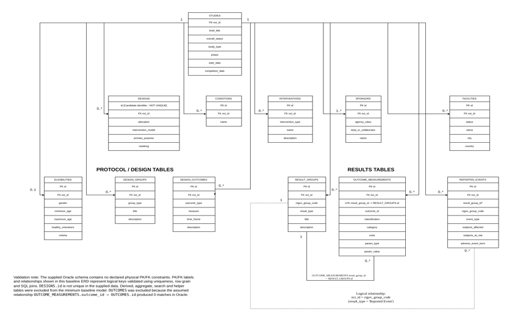

# Clinical Trials Database Reverse Engineering

A reverse-engineering project that analyses the structure, logical keys, relationships, and table roles of an **AACT clinical-trials Oracle database**.

The project demonstrates how an undocumented or weakly documented relational schema can be reconstructed using metadata inspection, row-grain analysis, uniqueness testing, relationship validation, and SQL evidence.



## Project Overview

The AACT database contains clinical-trial registration, protocol, study-design, facility, sponsor, outcome, and reported-results data.

Rather than assuming that similarly named columns represent valid relationships, this project independently validates the supplied Oracle schema using SQL.

The main objectives were to:

- Discover the available schema structure
- Identify logical primary and foreign keys
- Determine the grain of important tables
- Classify tables by their primary purpose
- Identify the minimum essential operational tables
- Separate protocol/design data from results data
- Validate relationships using actual database evidence
- Construct a defensible baseline ERD

The supplied Oracle database was treated as the authoritative source rather than relying on assumptions from external AACT documentation.

## Technologies

- Oracle Database
- Oracle SQL
- DBeaver
- Relational Database Modelling
- Schema Reverse Engineering
- Data Profiling
- ERD Design
- Draw.io

## Reverse Engineering Approach

The investigation followed an evidence-driven workflow:

```text
Schema Discovery
      ↓
Metadata Inspection
      ↓
Row-Grain Analysis
      ↓
Uniqueness Testing
      ↓
Relationship Validation
      ↓
Table Classification
      ↓
Essential Table Selection
      ↓
Baseline ERD
```

The SQL script contains **60 structured validation queries** covering schema discovery, logical-key validation, table classification, relationship testing, outcome modelling, and final ERD validation. 

## Schema Discovery

The first stage inspects:

- All tables in the `AACT` schema
- Declared Oracle constraints
- Table columns and data types
- Candidate identifiers
- Potential parent-child relationships

A key discovery was that the supplied teaching schema contains **no declared physical primary-key or foreign-key constraints**.

Therefore, relationships had to be inferred and validated using:

- Uniqueness
- Null analysis
- Row grain
- Join coverage
- Orphan detection
- Cross-table identifier comparison

The SQL explicitly tests the Oracle metadata before defining logical relationships.

## Central Entity — STUDIES

`STUDIES` was identified as the central entity in the operational model.

The database contained:

**593,330 STUDIES rows**

with:

**593,330 distinct `nct_id` values**

This supported treating:

```text
STUDIES.nct_id
```

as the logical primary key for the central clinical-trial record.

Major child tables were also tested for orphan `nct_id` values, providing evidence that study-linked records belong to valid clinical trials.

## Table Classification

Tables were classified according to their primary purpose.

### Final Classification

| Category | Final Classification |
|---|---|
| Master | `STUDIES` |
| Transaction | `PENDING_RESULTS` |
| Lookup | `MESH_TERMS`, `MESH_HEADINGS` |
| Time-series | No suitable table identified |
| Versioning | No suitable table identified |
| Partitioned | `BRIEF_SUMMARIES`, `DETAILED_DESCRIPTIONS` |
| Temporary aggregate | `REPORTED_EVENT_TOTALS`, `OUTCOME_COUNTS`, `BASELINE_COUNTS` |

The final classification differed substantially from several initial assumptions because table names alone did not reliably describe their actual role.

For example, `PENDING_RESULTS` was identified as the transaction-like table because it records dated operational events such as:

```text
RELEASE
RESET
UNRELEASE
```

The table contained **33,198 event rows**.

## Essential Operational Tables

The final baseline contains **12 essential operational tables**.

### Core Study / Protocol Tables

- `STUDIES`
- `ELIGIBILITIES`
- `DESIGNS`
- `CONDITIONS`
- `INTERVENTIONS`
- `SPONSORS`
- `FACILITIES`
- `DESIGN_GROUPS`
- `DESIGN_OUTCOMES`

### Results Tables

- `RESULT_GROUPS`
- `OUTCOME_MEASUREMENTS`
- `REPORTED_EVENTS`

The model intentionally excludes many derived, search, aggregate, and helper structures in order to keep the baseline focused on the core clinical-trial lifecycle.

The final selection retained ten initially proposed operational tables, replaced `OUTCOMES` with `DESIGN_OUTCOMES`, and added `DESIGN_GROUPS`.

## Protocol vs Results Separation

One of the most important findings was the distinction between **planned protocol outcomes** and **reported results**.

### Protocol Side

`DESIGN_OUTCOMES` represents planned outcome measures defined during study design.

### Results Side

Result-related information is represented through structures including:

- `RESULT_GROUPS`
- `OUTCOME_MEASUREMENTS`
- `REPORTED_EVENTS`

This distinction prevents protocol definitions from being incorrectly interpreted as reported clinical results.

## Rejected Relationship

A particularly important validation tested the apparent relationship:

```text
OUTCOME_MEASUREMENTS.outcome_id
        ↓
OUTCOMES.id
```

Despite the similar column names, the join produced:

**0 matches out of 2,107,902 OUTCOME_MEASUREMENTS rows**

This demonstrated why reverse engineering must rely on database evidence rather than naming conventions.

The relationship was therefore excluded from the final baseline model.

The SQL contains dedicated tests for this assumed relationship and its orphan behaviour.

## RESULT_GROUPS Validation

`RESULT_GROUPS` is an important intermediate structure in the results model.

The relationship:

```text
OUTCOME_MEASUREMENTS.result_group_id
        ↓
RESULT_GROUPS.id
```

was strongly supported by the database.

Of the `OUTCOME_MEASUREMENTS` records:

- **2,107,379** non-null `result_group_id` values matched `RESULT_GROUPS.id`
- **523** rows had a null `result_group_id`

This relationship was therefore retained in the final ERD.

## Reported Events Relationship

`REPORTED_EVENTS.result_group_id` was not treated as a reliable direct relationship in every case.

Instead, the validated logical relationship uses:

```text
nct_id
+
ctgov_group_code
+
result_type = 'Reported Event'
```

Using this relationship, approximately:

**9.75 million REPORTED_EVENTS rows**

were successfully linked to the corresponding result groups.

The SQL explicitly validates this composite logical relationship.

## Non-Unique Candidate Keys

Another important finding concerned:

```text
DESIGNS.id
```

Although `id` initially appears to be a natural candidate identifier, the database contained:

- **638,553 DESIGNS rows**
- **588,553 distinct `id` values**

Therefore:

```text
DESIGNS.id
```

cannot safely be treated as a unique logical primary key in the supplied dataset.

Dedicated SQL queries also test duplicate `DESIGNS.id` values and duplicate `(id, nct_id)` combinations.

## Baseline ERD

The final ERD contains only relationships supported by Oracle evidence.


The model separates:

### Protocol / Design

- STUDIES
- ELIGIBILITIES
- DESIGNS
- CONDITIONS
- INTERVENTIONS
- SPONSORS
- FACILITIES
- DESIGN_GROUPS
- DESIGN_OUTCOMES

### Results

- RESULT_GROUPS
- OUTCOME_MEASUREMENTS
- REPORTED_EVENTS

The ERD also documents that the displayed PK/FK relationships represent **logical relationships discovered through reverse engineering**, rather than physical Oracle constraints.

## Key Findings

Several assumptions were changed after independent validation:

- `STUDIES.nct_id` behaves as the central logical study identifier.
- The supplied schema has no declared physical PK/FK constraints.
- Similar column names do not necessarily represent valid relationships.
- `PENDING_RESULTS` is the strongest transaction-table candidate.
- No convincing time-series or versioning table was identified.
- `DESIGN_OUTCOMES` represents planned protocol outcomes.
- `DESIGN_GROUPS` is required to represent protocol study arms/groups.
- `OUTCOME_MEASUREMENTS.outcome_id → OUTCOMES.id` is unsupported.
- `OUTCOME_MEASUREMENTS.result_group_id → RESULT_GROUPS.id` is strongly supported.
- Reported events are best connected through `nct_id + ctgov_group_code`.
- `DESIGNS.id` is not unique in the supplied data.

## SQL Validation Areas

The SQL workflow includes tests for:

- Oracle schema discovery
- Column metadata
- Physical constraints
- Logical primary keys
- Logical foreign keys
- Duplicate identifiers
- Null identifiers
- Orphan records
- Table row grain
- Study coverage
- Candidate master tables
- Transaction tables
- Lookup tables
- Partitioned tables
- Aggregate tables
- Versioning candidates
- Result-group relationships
- Outcome identifier domains
- Protocol vs results structures
- Final ERD relationships

## Example Validation Pattern

A recurring reverse-engineering technique used throughout the project is orphan detection:

```sql
SELECT COUNT(*) AS orphan_rows
FROM child_table c
LEFT JOIN parent_table p
    ON c.logical_foreign_key = p.logical_primary_key
WHERE c.logical_foreign_key IS NOT NULL
  AND p.logical_primary_key IS NULL;
```

A zero or near-zero orphan count, combined with appropriate uniqueness and grain evidence, provides support for a potential logical relationship.

## Repository Structure

```text
clinical-trials-database-reverse-engineering/
│
├── reverse_engineering.sql
├── aact_baseline_erd.png
└── README.md
```

## Running the SQL

The complete validation workflow is contained in:

```text
reverse_engineering.sql
```

The script is designed for the supplied Oracle AACT schema and contains read-only analytical queries.

It can be run section-by-section in DBeaver or another Oracle-compatible SQL client.

The major sections are:

```text
1. Schema discovery
2. Central entity validation
3. Logical key and relationship validation
4. Master and transaction candidate validation
5. Lookup candidate validation
6. Time-series and outcome investigation
7. Versioning investigation
8. Partitioned table validation
9. Aggregate table validation
10. Outcome and results relationship validation
11. Final baseline ERD validation
```

## Reverse Engineering Principles Demonstrated

This project demonstrates several core database-engineering practices:

- Never infer relationships from column names alone
- Validate candidate keys against actual uniqueness
- Verify foreign-key assumptions using joins
- Inspect row grain before classifying tables
- Separate logical relationships from physical constraints
- Distinguish operational data from derived/reporting structures
- Use evidence to reject plausible but unsupported schema assumptions
- Build ERDs from validated relationships rather than documentation alone

## Data Availability

The underlying Oracle AACT teaching database is not redistributed in this repository.

The repository contains only the SQL validation workflow and the derived baseline ERD required to demonstrate the reverse-engineering process.

## Author

**Arham Chowdary**

Master of Data Science  
Oracle SQL · Database Reverse Engineering · Data Modelling · Schema Validation
